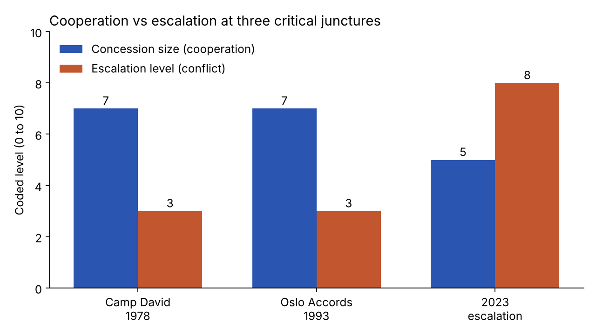
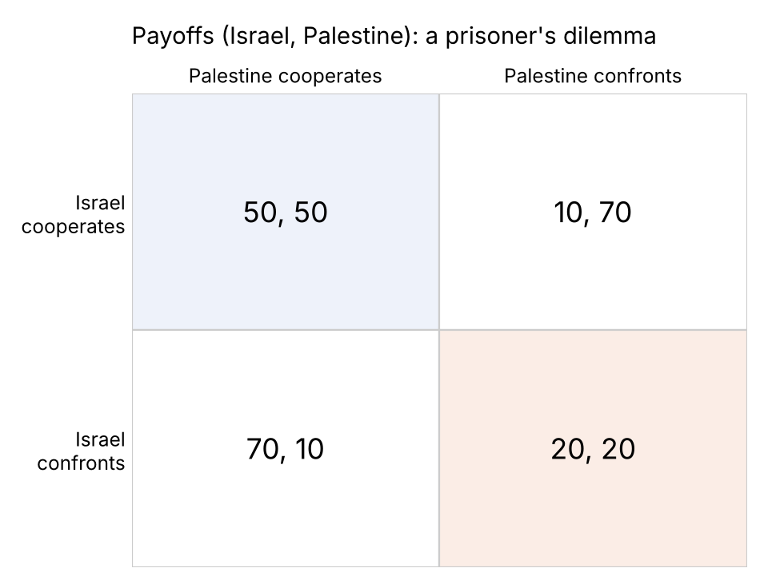
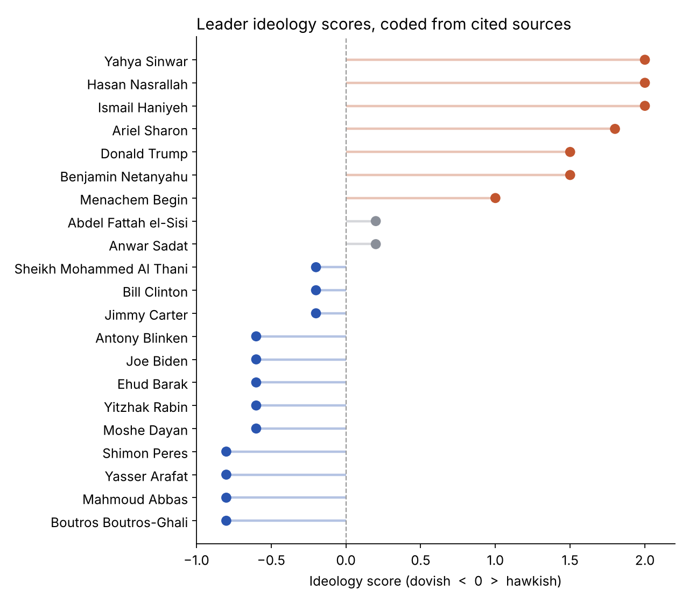

# Why Ceasefires Break: Leadership, Ideology and Behavioural Game Theory in the Israel-Palestine Conflict

Research paper and Python model by **Suleman Yousaf**, Ghent University (Research Paper Conflict and Development, 2025).

**Case study:** [fantastic-kitten-47330d.netlify.app/israel-palestine.html](https://fantastic-kitten-47330d.netlify.app/israel-palestine.html)

## Question

Why are ceasefires in the Israel-Palestine conflict so short-lived, and how do the ideologies of the leaders at the table shape whether cooperation holds?

The study looks at three critical junctures between 1978 and 2023 and models each as a sequential and repeated game. It adds the behavioural biases that classical game theory leaves out: loss aversion, trust that decays after a betrayal, and bounded rationality.

## Approach

1. **Coded the junctures.** Camp David (1978), the Oslo Accords (1993) and the 2023 escalation were coded from archival and secondary sources, plus a scenario projection for 2024. Each juncture is scored for concession size and escalation level on a 0 to 10 scale.
2. **Scored 21 leaders' ideology.** Each leader was placed on a left to right scale from cited sources, from Begin and Sadat to Netanyahu, Sinwar and the Qatari mediators.
3. **Built the game models.**
   - Payoff matrices for Israel and Palestine.
   - Game trees for each juncture.
   - Repeated-game simulations in which each side's probability of cooperating depends on its leader's ideology and on trust built up or lost in earlier rounds.



## The model

Each leader's probability of cooperating falls as their ideology score `s` rises:

```
P(cooperate) = 0.5 - 0.4 × s
Expected duration of cooperation = (P_IL × P_PL) / (1 - P_IL × P_PL)
```

The repeated-game simulations add the following:
- trust that rises after mutual cooperation and falls after defection
- a learning rate
- misperception of the other side's move
- bounded rationality



**Hypothesis.** Ceasefires hold under dovish leadership with high cooperation probabilities, as at Camp David and Oslo. They break down under hawkish leadership, where loss aversion and trust decay push both sides to defect, as in 2023.



## Repository

| Path | What it is |
|---|---|
| `israel_palestine_game_theory.py` | The full analysis, exported from Google Colab |
| `data/junctures.csv` | Concession and escalation scores for the three junctures |
| `data/leader_ideology_scores.csv` | Ideology score, rationale and source for each of the 21 leaders |
| `docs/leader_ideology_scores_with_sources.pdf` | The leader scoring table with full references |
| `figures/` | Charts used in this README |

## Running it

The script was written in Google Colab and keeps Colab commands such as `!pip install` and `display(...)`. The easiest way to run it is to open it in [Colab](https://colab.research.google.com) and run it section by section. To run it locally, install the requirements and remove the `!pip` lines:

```
pip install -r requirements.txt
```

Graphviz also needs the system package (`apt install graphviz` or `brew install graphviz`) to render game trees.

## Limitations

- Ideology scores and concession or escalation levels are coded from documents, so they carry interpretation.
- Three junctures is a small sample. The model illustrates a mechanism; it is not a forecast.
- Outside actors and domestic politics enter only through the leaders who represent them.

## Author

Suleman Yousaf, MSc Conflict and Development Studies, Ghent University
[LinkedIn](https://www.linkedin.com/in/suleman-yousaf-397701214) · [Portfolio](https://fantastic-kitten-47330d.netlify.app)
